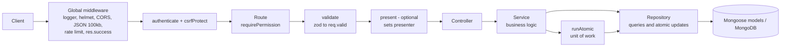
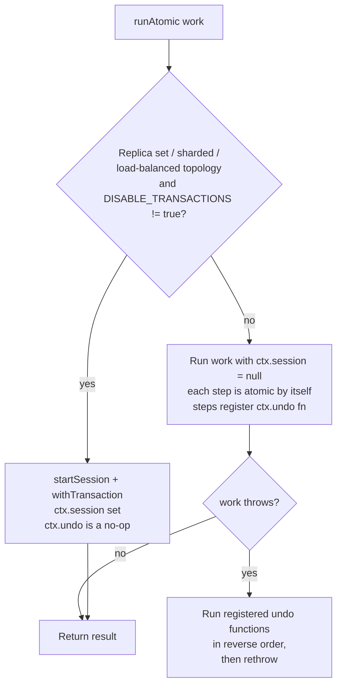
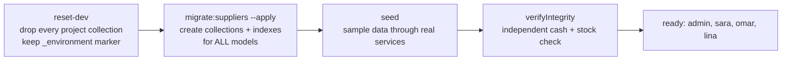

# Poplar v3 — Overview

This document explains how the system is built and operated: architecture, configuration, security, running and deploying, the database workflow, migrations, tests, the frontend, troubleshooting and known limits.

Companion documents: [README](../README.md) · [02-features.md](02-features.md) (pages and business rules) · [03-data-model.md](03-data-model.md) (collections) · [04-api.md](04-api.md) (endpoints).

## Contents

1. [Purpose and scope](#1-purpose-and-scope)
2. [Architecture](#2-architecture)
3. [Configuration](#3-configuration)
4. [Security](#4-security)
5. [Running, building and deploying](#5-running-building-and-deploying)
6. [Database, reset / migrate / seed workflow and safety gate](#6-database-reset--migrate--seed-workflow-and-safety-gate)
7. [Migrations](#7-migrations)
8. [Testing](#8-testing)
9. [Frontend architecture](#9-frontend-architecture)
10. [Troubleshooting](#10-troubleshooting)
11. [Known limits](#known-limits)

---

## 1. Purpose and scope

Poplar is an inventory, point-of-sale and finance system for a clothing store with two stock locations, **shop** (`shop`) and **warehouse** (`warehouse`). Two roles exist: `admin` (the owner) and `employee`. The owner configures what each employee may do.

Why v3 exists (problems of v2 that v3 fixes): business logic lived in route files; read-then-`save()` updates lost data under concurrency; CORS was open and there was no helmet, rate limit or validation; search used unanchored regexes with hard caps; there was no QR support; shipments had no idempotency. v3 introduces a layered architecture, atomic conditional updates, strict zod validation, QR codes, idempotency keys, series-based FIFO stock, server-side sessions and role-based access control. Later additions are the dual-currency cash ledger, the finance dashboard and supplier accounts with consignment.

## 2. Architecture

### 2.1 Layers

Each request flows through a fixed pipeline. Each layer has one job and a strict rule about what it may touch.



| Layer | Folder | Responsibility | Must not |
|---|---|---|---|
| Route | `src/routes` | Wires `method + path` to permission, validation, optional presenter and controller. | Contain logic or queries. |
| Validation | `src/validations` | One zod schema (`body` / `query` / `params`) per endpoint, `.strict()` so unknown fields are rejected. Shared primitives are in `common.js`. | Touch the database. |
| Controller | `src/controllers` | Reads `req.valid`, calls **one** service function, replies with `res.success(data, status)`. | Contain business rules. |
| Service | `src/services` | All business rules and orchestration. Returns raw data. | Import a Mongoose model (it talks to repositories only). |
| Repository | `src/repositories` | Every query, aggregate and atomic conditional update. Each repository imports its own model. | Contain business rules. |
| Model | `src/models` | Mongoose schema and indexes only. | Define methods. |
| Utils | `src/utils` | Pure helpers: money, series rules, sizes, model numbers, text normalisation, pagination, errors, password hashing, unit of work, logger. | Hold state. |

There is no separate domain layer. Display-only derived fields (per-size availability, `canTransfer`, `needsFactoryRestock`, totals) are computed by **presenters** when the response is ready.

Order of middleware for an authenticated route (from `routes/index.js` and the route files):

1. `requestLogger` — assigns `req.id` (UUID), sets `X-Request-Id`, logs method, path, status and duration (never request bodies).
2. `helmet` with the project CSP, then `cors`.
3. `express.json({ limit: "100kb" })`.
4. `/api` rate limiter, then `responseMiddleware` (adds `res.success`).
5. `authenticate` (session lookup) then `csrfProtect` for every router except `/health` and `/auth`.
6. `requirePermission(...)` (router level for `/users`, `/suppliers`, `/finance`; per route elsewhere), then field guards such as `forbidFieldsWithout`.
7. `validate(schema)` → `req.valid.{body,query,params}`.
8. `present("model" | "modelList" | "lookup" | "stockResult")` (only on some routes).
9. Controller → service → repositories.
10. `errorHandler` converts any thrown error into the standard error body.

An unknown `/api/*` path returns 404 `NOT_FOUND`. If `frontend/dist` exists, the app serves it statically and falls back to `index.html` for non-API GET requests.

### 2.2 Presenters and redaction

**Presenters** (`src/middleware/presenters`) are selected by the route with `present(name)`; the controller's `res.success` applies the named presenter to the data.

| Presenter | Input | Output |
|---|---|---|
| `model` | one model document with per-size shop/warehouse quantities (hydrated from series) | the unified model shape: identity fields, prices, `sizes[]` with `shopQty`, `warehouseQty`, `totalQty`, `availability` (`both`, `store_only`, `warehouse_only`, `out_of_stock`), `canTransfer`, `needsFactoryRestock`, plus `totals`, `availableSizes`, `outOfStockSizes`, `transferableSizes`, `restockSizes` |
| `modelList` | `{ items, ... }` | the same `model` shape for each item; search results keep `matchType` |
| `lookup` | `{ kind, model, size? }` | the model presented; for `kind: "size"` the matching size from the presented model |
| `stockResult` | `{ model, duplicate?, series? }` | `model` presented, other keys unchanged |

The alert rule (one place, `utils/stock.js`): shop = 0 and warehouse > 0 means `canTransfer` ("move from the warehouse"); both zero means `needsFactoryRestock` ("order a shipment"). A quantity of 1 never raises an alert.

**Redaction** (`middleware/redact.js`) runs inside `res.success` for every response. For any user **without** `costs.view` (every employee), these keys are removed at any depth of the JSON (invoice items, nested movements, aggregates):

`costPrice, costUsd, unitCostUsd, profitUsd, reversedProfitUsd, reversedProfit, writeOffUsd, fxDiffUsd, unitPriceUsd, totalUsd, refundUsd, refundUsdToday, costValueUsd, sellValueUsd, flag, flags, belowCost`

Employees keep `sellPrice`, `unitPrice`, `totalPaid`, `cashDue`, `refundAmount`, the exchange rate and everything the customer pays or receives. Accounting is still computed and stored in full; it is simply never sent. Because the filter lives in `res.success`, a new endpoint cannot forget to apply it.

### 2.3 Unit of work: `runAtomic`

`utils/unitOfWork.js` runs a multi-step operation (sale, return, cancellation, shipment, transfer, payment + allocation + cash, settlement, supplier return) as one unit.



- **With a replica set**: a real MongoDB transaction; `ctx.session` is passed to repository calls through `sessionOpts(ctx)`.
- **Without** (standalone `mongod`, or `DISABLE_TRANSACTIONS=true`): every repository write is individually atomic (conditional `$inc`/`findOneAndUpdate`), and each step registers an inverse with `ctx.undo(fn)`. On failure the undos run in reverse order (compensating rollback). A failing undo is logged, not thrown.
- Topology is detected once per process and cached. The caller writes one code path that supports both modes.
- MongoDB forbids parallel operations on one transaction session, so code that shares a `ctx` reads sequentially (no `Promise.all` with the same `ctx`).

Related primitives: unique **idempotency keys** (shipments, supplier postings, cash movements, expenses, settlements, supplier returns), **optimistic concurrency** (`rev` on models and series for weighted-average cost), and **atomic counters** (`counters` collection) for model numbers, invoice numbers, series numbers and references.

## 3. Configuration

Configuration is read from `backend/.env` (loaded by `dotenv`) through `src/config/env.js`. Copy `backend/.env.example` to `backend/.env`. Keep `.env` out of version control (it is git-ignored).

| Variable | Default | Meaning |
|---|---|---|
| `MONGO_URI` | required | MongoDB connection string. The project uses `mongodb://127.0.0.1:27017/poplar`. Startup fails with a clear message if missing. |
| `PORT` | `5000` | HTTP port. |
| `NODE_ENV` | `development` | `production` enables the `SESSION_SECRET` requirement and `Secure` cookies; `test` silences logs. |
| `SESSION_SECRET` | none | HMAC key for stored session ids. **Required in production**, at least 32 characters; startup fails otherwise. In development/test an unset value becomes a random per-process secret, so sessions end when the process restarts. Generate with `node -e "console.log(require('crypto').randomBytes(48).toString('hex'))"`. |
| `SESSION_IDLE_MINUTES` | `480` | Idle timeout (8 hours). |
| `SESSION_ABSOLUTE_DAYS` | `7` | Absolute session lifetime; also the cookie `maxAge` and the TTL of the stored session. |
| `COOKIE_SECURE` | `true` when `NODE_ENV=production`, else `false` | Force or disable the `Secure` cookie flag (set `false` only to try a production build over plain local http). |
| `CORS_ORIGINS` | empty | Comma-separated extra allowed origins. Empty means same-origin plus any local origin (`localhost`, `127.0.0.1`, `::1`, any port). |
| `LOG_LEVEL` | `info` (`silent` when `NODE_ENV=test`) | pino level. |
| `RATE_LIMIT_PER_MINUTE` | `600` | Per-IP request limit on `/api` (one-minute window). |
| `LOGIN_MAX_ATTEMPTS` | `8` | Failed logins per (IP + account) per 15 minutes; the per-IP limit is 4 times this. |
| `DISABLE_TRANSACTIONS` | `false` | `true` forces compensating rollback even on a replica set. The local `.env` sets `true` because a standalone `mongod` has no transactions. |
| `ADMIN_USERNAME`, `ADMIN_NAME`, `ADMIN_PASSWORD` | none | Optional, only read by `npm run create-admin` for non-interactive use. |
| `MONGO_TEST_URI` | none | Only read by the integration tests (see [Testing](#8-testing)). |
| `POPLAR_ENV` | none | If set to `production`, the safety gate refuses destructive scripts (like `NODE_ENV=production`). |

## 4. Security

### 4.1 Authentication and sessions

- **No public registration.** The first owner is created on the server with `npm run create-admin`:

  ```bash
  cd backend
  npm run create-admin                    # asks for username, display name, password (hidden, typed twice)
  npm run create-admin -- --additional    # deliberately add another owner when one exists
  npm run create-admin -- --reset         # recover access: new password for an existing owner, ends all their sessions
  ```

  It refuses to overwrite an existing account without `--reset`, never prints the password, and validates the password policy.
- **Server-side sessions** in the `sessions` collection. The browser gets the cookie `poplar_sid`: `HttpOnly`, `SameSite=Strict`, `Path=/api`, `Secure` in production. The cookie value is a 32-byte random token; only its **HMAC-SHA256 with `SESSION_SECRET`** is stored, so a leaked sessions collection cannot be replayed. No JWT, nothing in `localStorage`.
- Each session stores a CSRF token and the user's `tokenVersion`. Every request re-validates on the server: session exists, not past the absolute `expiresAt`, not idle longer than `SESSION_IDLE_MINUTES`, user still active, and `tokenVersion` equal. `lastSeenAt` is refreshed at most every 5 minutes. A TTL index deletes expired sessions.
- Login always issues a **fresh** session and deletes any session named by an old cookie (anti-fixation). Unknown user, wrong password and disabled account all return the same 401 `INVALID_CREDENTIALS`; a dummy scrypt hash is computed for unknown users so response time does not reveal which accounts exist.
- Sessions end on: logout, idle timeout, absolute timeout, account disabled, permissions changed, password changed or reset (`tokenVersion` is incremented and the user's sessions are deleted). Changing your own password deletes your other sessions and issues a new one.
- **Passwords**: scrypt (N = 2^15, r = 8, p = 1, 64-byte key, per-password random salt, stored as `scrypt$N$r$p$salt$hash`); policy: at least 10 characters, at most 128, letters and digits, must not contain the username.
- Login requires `Content-Type: application/json` (otherwise 415 `UNSUPPORTED_MEDIA_TYPE`).

### 4.2 CSRF

Every non-`GET`/`HEAD`/`OPTIONS` request to a protected route must carry the header `x-csrf-token` with the token returned by `POST /api/auth/login` or `GET /api/auth/me`; otherwise 403 `CSRF_INVALID`. The check is constant-time. Together with `SameSite=Strict` this blocks cross-site writes. The frontend keeps the token in memory only.

### 4.3 Rate limiting

| Limiter | Scope | Limit |
|---|---|---|
| Global | every `/api` request, per IP | `RATE_LIMIT_PER_MINUTE` per minute → 429 `RATE_LIMITED` |
| Login, per account | failed logins only, key = IP + normalised username | `LOGIN_MAX_ATTEMPTS` per 15 min → 429 `LOGIN_RATE_LIMITED` |
| Login, per IP | failed logins only | 4 × `LOGIN_MAX_ATTEMPTS` per 15 min (stops username rotation) |

Successful logins do not count against the login limiters.

### 4.4 Transport and headers

- `helmet` with a CSP: `script-src 'self'`; styles `'self'`, inline and Google Fonts; fonts from `fonts.gstatic.com` and `data:`; images `'self'`, `data:`, `blob:`; media `'self'`, `blob:` (camera); `connect-src 'self'`. `x-powered-by` is disabled.
- **CORS** is closed by default: same-origin, any local origin (any port), and `CORS_ORIGINS`. Credentials are allowed for those origins only. A disallowed cross-origin request is rejected by the CORS middleware and surfaces through the generic error handler.
- JSON body limit 100 kb (oversize → 413 `PAYLOAD_TOO_LARGE`; invalid JSON → 400 `INVALID_JSON`).
- Errors never leak internals: unexpected errors return a generic Arabic message with `INTERNAL_ERROR` and the `requestId`; details go to the log only. A database outage returns 503 `DB_UNAVAILABLE`.
- Serve over **HTTPS** in production (cookies are `Secure`) and configure Express `trust proxy` behind a reverse proxy so client IPs are correct for the rate limiters.

### 4.5 Authorization (RBAC)

The single source of truth is `src/config/permissions.js`. There are no scattered role checks. The `admin` role always has every permission. An `employee` has an explicit stored list, filtered against the grantable set on every request.

| Permission | Grants | Admin-only (never grantable) | Employee default |
|---|---|:---:|:---:|
| `models.read` | list/view models, facets, QR image, lookup, QR resolve | | yes |
| `models.manage` | create, edit, archive, restore models; suggest model number | yes | |
| `stock.receive` | receive shipments (`unitCostUsd` additionally needs `costs.manage`; supplier/consignment fields need `suppliers.manage`) | | yes |
| `stock.transfer` | transfer between shop and warehouse | | yes |
| `stock.damage` | record damaged pieces | | yes |
| `stock.adjust` | inventory count (set real quantity) | | no (owner may grant) |
| `series.read` | series log and series detail | | yes |
| `movements.read` | stock movement log | | yes |
| `invoices.read` | list/view invoices | | yes |
| `invoices.create` | sell (cashier) | | yes |
| `invoices.cancel` | cancel an invoice | | no (owner may grant) |
| `returns.read` | list returns | | yes |
| `returns.create` | returns and exchanges | | yes |
| `dashboard.view` | operational inventory dashboard | | yes |
| `settings.read` | read the exchange rate | | yes |
| `settings.manage` | change the exchange rate | yes | |
| `reports.view` | inventory report; deprecated sales summary | yes | |
| `costs.view` | receive cost, profit, margins, valuation fields in responses (disables redaction) | yes | |
| `costs.manage` | enter `unitCostUsd` when receiving | yes | |
| `users.manage` | employee accounts | yes | |
| `suppliers.manage` | **all** supplier accounts, consignment, settlements, supplier returns; link a shipment to a supplier | yes | |
| `finance.manage` | **all** finance endpoints (dashboard, cash ledger, expenses) | yes | |
| `employees.read` / `employees.manage` | employee financial profiles: list/view / create, edit, salary, link to a login account | yes | |
| `payroll.read` | employee accounts, payroll periods, employee ledger | yes | |
| `payroll.manage` | create periods; allowances, bonuses, deductions (draft only) and their reversal | yes | |
| `payroll.approve` | approve and close payroll periods | yes | |
| `payroll.pay` | salary payments and their reversal | yes | |
| `advances.read` / `advances.manage` | view advances / create, disburse, settle, reassign the deduction period | yes | |
| `advances.reverse` | cancel/reverse advances and settlements | yes | |

**Payroll permissions policy.** The nine payroll permissions are registered in `config/permissions.js` and are **owner-only** (`ADMIN_ONLY`), like `finance.manage`: salaries are confidential and the existing grantable set is unchanged. Routes still check the narrow permission, so delegating later (for example `payroll.pay` to a cashier-accountant) means moving that name from `ADMIN_ONLY` to the grantable set and adding a label in the employee form; no route changes are needed. This is a policy decision, not a technical limit.

Rules around accounts (`user.service.js`):

- A new account is **always** an `employee`; the API has no `role` field (a body containing `role` is rejected by the strict schema).
- `permissions` supplied on create/update are filtered to the grantable set; an owner-only permission can never be stored for an employee.
- Owner accounts cannot be edited, disabled or reset through the API (`ADMIN_ACCOUNT_PROTECTED`); they are managed by the `create-admin` script only.
- Changing an employee's permissions or active flag, or resetting their password, increments `tokenVersion` and deletes their sessions, so the change is effective immediately.
- Frontend permission checks only shape the UI. The server enforces everything: employees get 403 on all `/suppliers` and `/finance` routes and never receive supplier names, balances, prices or ownership of series other than the plain `ownership` flag.

## 5. Running, building and deploying

### 5.1 Development

```bash
# MongoDB (local only)
mongod --dbpath ./mongo-data --bind_ip 127.0.0.1 --port 27017

# Backend: http://localhost:5000
cd backend && cp .env.example .env && npm install && npm run dev

# Frontend: http://localhost:5173 (proxies /api to :5000)
cd frontend && npm install && npm run dev
```

If you start from an empty database, create the owner with `npm run create-admin` or build the sample data (section 6). Port conflicts usually come from duplicate Node processes; check what listens on `:5000` first.

### 5.2 Production-style run

```bash
cd frontend && npm run build          # writes frontend/dist
cd ../backend && NODE_ENV=production SESSION_SECRET=<32+ chars> npm start
```

The backend serves `frontend/dist` and the API from one process on `:5000`. `server.js` connects to MongoDB (`serverSelectionTimeoutMS: 15000`), starts listening, and on `SIGTERM`/`SIGINT` stops accepting requests, closes the connection and exits (forced exit after 10 s). `GET /api/health` returns `{ ok: true, db: "up" | "down" }` for monitoring.

Checklist for a real deployment:

- `NODE_ENV=production`, a strong `SESSION_SECRET`, HTTPS in front, `trust proxy` configured, `COOKIE_SECURE` left at its production default.
- Restrict `CORS_ORIGINS` (leave empty when the UI is served by the same backend).
- Back up the database before any migration. Never run `reset-dev` or `seed --reset` against real data (the safety gate also refuses production).
- Optional: run MongoDB as a replica set (see below) so multi-document operations use real transactions.

### 5.3 Enabling transactions locally

Add `replication: { replSetName: rs0 }` to `mongod.cfg` (or start with `--replSet rs0`), run `rs.initiate()`, remove `DISABLE_TRANSACTIONS=true` from `.env`, and use `MONGO_URI=mongodb://127.0.0.1:27017/poplar?replicaSet=rs0`. At startup the log line `transaction support detected` shows the chosen mode.

### 5.4 Atomicity of financial operations: what is guaranteed where

Multi-step money operations (salary payment, advance issue/disburse/settle, carry-forward, close month, reversals, expenses, supplier payments) run in `runAtomic`:

| Deployment | Mechanism | Guarantee |
|---|---|---|
| **Replica set** (`DISABLE_TRANSACTIONS` unset/false) | one MongoDB transaction | all-or-nothing across expense, cash movement, ledger entry, counters and advance state, **including a process crash** (uncommitted work is discarded by the server). |
| **Standalone** (`DISABLE_TRANSACTIONS=true`, the local default in this repository's `.env`) | each write is atomic; failures are undone by compensating steps (including deleting the not-yet-complete ledger/expense rows) | correct for every handled error and for concurrent requests (unique keys + conditional updates), but **not crash-safe**: a process kill between two writes can leave a partial operation (for example a cash movement whose expense link was not written, or a payment entry without its expense). |

Detection after a crash: `scripts/lib/verify.js` (`verifyIntegrity`, used by the seed and tests) checks that every salary expense has its payment entry with the same amount and vice versa, that cash movements match their sources, and that period/advance counters equal the sum of their ledger entries. There is no automatic recovery: a reported problem needs a manual correction by reversal entries. **Recommendation:** run MongoDB as a (single-node) replica set and remove `DISABLE_TRANSACTIONS=true` for any deployment holding real financial data (section 5.3). This is a deployment decision; the application does not change topology or `.env`.

## 6. Database, reset / migrate / seed workflow and safety gate

The project uses **only the local MongoDB**: `mongodb://127.0.0.1:27017/poplar`, `mongod` with dbpath `mongo-data/`, bound to `127.0.0.1:27017`. A standalone `mongod` has no transactions, so `.env` sets `DISABLE_TRANSACTIONS=true`. Start order: `mongod`, backend, frontend.

### 6.1 The workflow



```bash
cd backend
npm run reset-dev -- --confirm-db=poplar [--mark-disposable]   # wipe every project collection
npm run migrate:suppliers -- --apply                           # build schema and indexes (dry run without --apply)
npm run seed -- --confirm-db=poplar [--reset]                  # dual-currency sample data + integrity check
```

| Script | Arguments | Behaviour |
|---|---|---|
| `reset-dev` | `--confirm-db=<name>` (required), `--mark-disposable` (first time only) | Disables Mongoose auto-create/auto-index, passes the gate, drops **every** collection except the `_environment` marker and `system.*`, then verifies nothing is left. Touches no other database, no files, no `.env`. |
| `migrate:suppliers` | `--apply`, `--rollback` | Dry run by default. With `--apply`: EJSON backup, idempotent data steps, then `createCollection()` + `syncIndexes()` for **every** model in `src/models`. This is what rebuilds the schema after `reset-dev`. |
| `seed` | `--confirm-db=<name>` (required), `--reset` | Passes the gate, refuses a non-empty database unless `--reset` is given (`--reset` clears the project collections' content and rebuilds), builds data through the real services, then runs `verifyIntegrity`; any problem fails the run. |

### 6.2 Safety gate (`scripts/lib/safety.js`)

Used by `reset-dev` and `seed`. It does not depend on the database name and has no default and no fallback variable. **Nothing is deleted unless all checks pass:**

| # | Check |
|---|---|
| 1 | Not production: `NODE_ENV` and `POPLAR_ENV` are not `production`. |
| 2 | The URI is not `mongodb+srv` and every host is `localhost`, `127.0.0.1` or `::1`. |
| 3 | The URI contains a database name that is not a system database (`admin`, `config`, `local`). |
| 4 | `--confirm-db=<name>` is present and equals the database name in `MONGO_URI` (and the connected database must equal it too). |
| 5 | The database holds only collections that belong to this project (derived from the models' collection names plus `_environment`); any foreign collection means a shared or unknown database and the run is refused. |
| 6 | The database carries the disposable marker: document `{ _id: "environment", disposable: true, database: <name> }` in collection `_environment`. It is created once by `--mark-disposable` (the owner's explicit approval for this one database). A marker naming another database, or one not saying `disposable: true`, is refused. |

Before deleting anything the script prints the target, whether it is a replica set or standalone, and the document count of every collection.

### 6.3 Seed contents and determinism

The seed runs through the real services (FIFO, series, movements, invoices, returns, cash ledger, supplier ledger, settlements), so no number contradicts the system's rules. Names and phone numbers are fictional. Idempotency keys are deterministic (`seed-key-0001`, ...), so a re-run yields identical data.

What it creates (current local `poplar` database):

| Collection | Count |
|---|---:|
| Models (`product_models`) | 9 |
| Series | 39 |
| Shipments | 24 |
| Stock movements | 158 |
| Customer invoices | 18 |
| Returns | 6 |
| Suppliers | 8 |
| Supplier invoices | 8 |
| Supplier ledger entries | 18 |
| Supplier allocations | 5 |
| Supplier settlements | 3 |
| Supplier returns | 2 |
| Cash movements | 42 |
| Expenses | 6 |

Scenarios covered: opening series for two models, shop and warehouse shipments, partial transfers (derived series), damage, inventory counts up and down, sales in USD and SYP, an invoice sold below the selling price and one below cost, two cancellations (one in SYP), cash returns (including one with an exchange-rate difference and one damaged), two same-currency exchanges (USD and SYP), an archived-then-restored model, and an exchange-rate change from 14,000 to 15,000 SYP per USD before the SYP returns. Suppliers appear in every account state (settled, due, advance, mixed; SYP and USD), including a cross-currency payment, an allocation of an advance to an invoice, consignment goods priced in USD and in SYP with partial settlement, a reversed settlement, supplier returns, a reversed wrong advance and a deactivated supplier. Cash ledger: opening balances of $8,000 and 40,000,000 ل.س dated 40 days back, plus sales, refunds, supplier payments, expenses and a reversed expense. Final balances: **19,540,000 ل.س** and **$7,028.00**, never summed. Invoice dates are spread over the last weeks so day/month reports are meaningful.

### 6.4 Integrity check (`scripts/lib/verify.js`)

`verifyIntegrity(db)` re-derives each currency's cash balance **independently from source documents** (completed invoices' `cashDue`, minus cash refunds, minus supplier payments and advances not reversed, minus posted expenses, plus manual movements) and compares it with the ledger sum. It also verifies: every cash movement has an existing source of the same currency and amount; reversals match their originals; no duplicate non-reversal movement per source and direction; supplier entries and allocations reference existing records, currencies match, same-currency allocations have equal amounts, cross-currency allocations carry an explicit rate, allocations never exceed the credit or invoice amount; consignment `settledQty` equals live settlements and never exceeds net sold; no settlement without an agreed price or in two currencies; no negative stock; received series never exceed 2 pieces per size; every movement and supplier return references an existing series. The same function backs the seed, `seed.reset.test.js` and the tests.

### 6.5 Accounts (local development only)

| Username | Password | Role / access |
|---|---|---|
| `admin` | `Poplar-Local-2026!` | admin: everything |
| `sara` | `Shop-Staff-2026` | employee: default permissions |
| `omar` | `Stock-Keeper-2026` | employee: defaults + stock adjust + cancel invoices |
| `lina` | `Cashier-Desk-2026` | employee: cashier only (`models.read`, `invoices.create`, `returns.create`, `settings.read`) |

The seed also stores the default exchange rate used for SYP sales (15,000 SYP per USD at the end of the seed).

## 7. Migrations

Run from `backend/`. All three migration scripts are dry-run first and idempotent. `backups/` receives EJSON backups and reports (its contents are git-ignored).

### 7.1 `migrate-v3` (v2 to v3, existing v2 data only)

```bash
npm run migrate                # dry run: prints the plan, writes nothing
npm run migrate -- --apply     # full EJSON backup, then migrate
```

Each v2 product × (cut + colour) becomes its own **model** with its own number; v2 colour is kept in `notes` and `legacy.color`. Barcodes, quantities (still in the old `shopQty`/`warehouseQty` fields), invoices, returns and movements are kept and re-linked. The old `products` collection is never modified or deleted. Invalid sizes are repaired with a warning.

### 7.2 `migrate-series` (legacy quantities to series)

```bash
npm run migrate:series
npm run migrate:series -- --apply     # backup, create series, verify totals
```

There is nothing in v2 data that says which pieces belong together, so no groupings are invented: each (model, location) with a quantity becomes **one `balance` series** (`shipmentRef: "MIGRATION"`) carrying the current quantities; it is exempt from the 1–2 rule. The old `shopQty`/`warehouseQty` fields, invoices and movements are untouched (rollback path). Totals are verified after applying (no loss, no duplication).

### 7.3 `migrate-suppliers` (suppliers, consignment and the two cash accounts)

Additive: it creates the collections `suppliers`, `supplier_invoices`, `supplier_entries`, `supplier_allocations`, `supplier_settlements`, `supplier_returns`, `cash_movements`, `expenses` (and, because it syncs every model, all project indexes) and adds optional fields to `series` and `shipments`. Customer invoices, returns, movements, the legacy `products` collection and stock quantities are untouched. A series without `ownership` behaves as `owned`.

```bash
cd backend
npm run migrate:suppliers                          # DRY RUN (default): full report, writes nothing
npm run migrate:suppliers -- --apply               # EJSON backup (backups/pre-suppliers-*.json) then the steps below
npm run migrate:suppliers -- --rollback --apply    # removes ownership fields only; REFUSES if supplier/consignment/cash/expense data exists
```

**The dry run reports:** what would change per collection and field; counts of series without ownership, consignment series and consignment series without a price; supplier entries and invoices that need native fields; allocations (safe / deterministically rebuilt / needing review); settlements (safe / needing review); collection counts; and the **cash reconciliation block** — completed customer invoices, customer cash refunds and supplier payments/advances that have no cash movement, per currency, plus invoices with an ambiguous currency.

**`--apply` steps (all idempotent):**

1. `ownership = "owned"` on series that have none (consignment is never guessed).
2. Derive `amountMinor` / `signedMinor` on old supplier entries and `amountMinor` on old supplier invoices from the original amount and currency. Old USD-equivalent fields never feed any balance.
3. Old allocations: USD/USD ones are labelled with their currencies; `direct` ones are rebuilt from their payment entry in its own currency; anything with ambiguous units is flagged `needsReview` and excluded from balances.
4. Old settlements are migrated only if entirely in USD; others are flagged for review and left untouched.
5. Consignment series without an agreed price are listed (no price is invented).
6. Create collections and sync indexes for every model.
7. Write `backups/finance-reconciliation-*.json` listing every item that needs manual review.

It **never** creates cash movements, opening balances, prices, currencies or classifications. After reviewing the report the owner enters each cash account's opening balance in **Finance → «حركات الصندوقين»** using a manual deposit.

**Rollback** removes `supplier`, `ownership` and `consignment` from series only, and refuses when any supplier, consignment, cash or expense data exists (financial data is never deleted).

The production database has never had this migration applied. Back it up and read the dry run first. The local development database was rebuilt with the workflow in section 6.

## 8. Testing

All tests use Node's built-in runner. Current totals: **73 unit**, **38 HTTP**, **9 frontend** tests pass without a database; integration tests need MongoDB (**133** tests on standalone `mongod`; the payroll, employee-finance, cash and supplier suites also pass on a replica set with transactions). One concurrency test (`employee-advance-flow` › *3. retries*) is timing-sensitive when all integration files run in parallel on a many-core machine; see [CHANGELOG.md](../CHANGELOG.md#known-issues). CI runs the integration files serially (`node --test --test-concurrency=1`) against both a standalone server and a single-node replica set.

| Command | Scope |
|---|---|
| `cd backend && npm test` | **Unit** (`tests/unit`, 73 tests; includes `payroll-utils.test.js`: payroll formulas, derived status, transitions, period bounds, indicators, ledger-to-counter reconstruction, integer money, month arithmetic, eligible deduction month, settlement/carry-forward projection): presenters and utils, response middleware and redaction, series rule, pure service helpers, validations and error handler, supplier accounting rules in integer minor units (`supplier-account.test.js`). |
| `cd backend && npm run test:http` | **HTTP without a database** (`tests/http`, 38 tests): validation, security headers, no error leakage, auth/login/logout, session fixation, CSRF, login rate limit, expiry, RBAC matrix, `unitCostUsd` field guard, admin-only supplier and finance endpoints, strict validation of supplier/finance bodies. |
| `cd backend && MONGO_TEST_URI="mongodb://127.0.0.1:27017/poplar_test" npm run test:integration` | **Integration** (`tests/integration`), needs MongoDB. |
| `cd frontend && npm test` | **Frontend** (`tests/utils.money.test.js`, `tests/payroll.utils.test.js` and `tests/users.utils.test.js`, 9 tests): money formatting (below), the pure payroll UI rules (amount validation, primary action per state, action availability, open-period selector) and the user-form validation rules. There is no DOM/component test runner in the project, so React components are verified in a real browser instead (see below). |
| `cd backend && npm run test:all` | Unit + HTTP + integration. |

**Integration tests.** Without `MONGO_TEST_URI` they are **skipped, not passed**. The URI's database name must contain `test` or the suite refuses to run. They **wipe their database**, so use a throwaway database. Each file derives its own database from the URI so files can run in parallel:

| File | Covers | Database used |
|---|---|---|
| `inventory.flow.test.js` | receive, transfer, sale, cancel, return, FIFO, idempotency, concurrency | the URI as given (e.g. `poplar_test`) |
| `auth.rbac.test.js` | sessions and RBAC against a real database | `<name>_rbac` |
| `series.migration.test.js` | legacy quantities to balance series | `<name>_migration` |
| `supplier.accounts.test.js` | supplier ledger, allocation, consignment, settlement | `<name>_suppliers` |
| `supplier.migration.test.js` | the `migrate:suppliers` script (dry run, apply, repeat, rollback) | `<name>_supmig` |
| `cash.finance.test.js` | cash ledger, expenses, finance dashboard | `<name>_cash` |
| `employee-finance.test.js` | salary expense (auto period, partial/full, non-cash, validation, idempotency and concurrency), one-step advance and default deduction month, automatic settlement, partial settlement and carry-forward, reversals via the expense, atomicity (injected cash failure), SYP register, RBAC, adjustments, and the independent integrity check | `<name>_empfin` |
| `employee-finance-fixes.test.js` | audit remediation: idempotency-key fingerprint (salary, advance, adjustment, settlement; concurrent conflicting keys), single payment path for the legacy endpoint, atomic close with failure injection, list = account in six scenarios, server-owned month, hire-month / known-salary eligibility, inactive employee carry, salary-category normalisation, reversal permission, failure injection at six stages of a salary payment, integrity check detecting crash residue | `<name>_efix` |
| `employee-advance-flow.test.js` | advance accounting vs reports: cash advance (−register, linked cash row, outstanding +), non-cash, retries/concurrency, salary-deduction settlement (no cash, no expense), partial settlement + carry-forward, reversals (history kept, cash once), and that dashboard expenses / expenses-by-category / net profit / expense rows never include advances and equal the sum of posted expense rows | `<name>_advflow` |
| `payroll.test.js` | employees, periods, advances, settlements, payments, reversals, atomicity (injected cash failure), idempotency, concurrency (parallel same-key and over-payment races), RBAC for every payroll endpoint, SYP register isolation | `<name>_payroll` |
| `seed.reset.test.js` | safety gate refusals, full reset → migrate → seed twice, idempotency, cash reconciliation, seeded accounting scenarios, redaction for employees | `<name>_seedflow` |

**Replica-set (transaction) run.** To exercise the transaction path, start a throwaway `mongod` with `--replSet rs0` on another port and a temporary dbpath, initiate it, then:

```bash
DISABLE_TRANSACTIONS=false MONGO_TEST_URI="mongodb://127.0.0.1:27018/poplar_test?replicaSet=rs0" npm run test:integration
```

Without a replica set the same tests run through the compensating-rollback path. Kill only the throwaway server, never your working `mongod` on `27017`.

**Money formatting tests (frontend).** `usd(-1042)` must render `-$1,042.00` (sign before the symbol); `usd(1042)` → `$1,042.00`; `usd(-0.001)` → `$0.00` (no sign for a value that rounds to zero); `syp(19540000)` → `19,540,000 ل.س`; `syp(-21060000)` → `-21,060,000 ل.س`; `money(-1042, "SYP")` → `-1,042 ل.س`.

The UI is also verified by a production build (`npm run build`). There is no lint or type-check script. Browser checks used headless Edge and headless Chrome (both Chromium, so not independent engines) driven over the DevTools protocol against a throwaway seeded database and a second backend on another port. They covered: RTL and page-overflow at 1280, 820 and 390 px for all 13 pages; the "المزيد" menu (click, Arrow keys, Escape, outside click, touch); sidebar groups; cashier cart persistence across navigation; the invoice-cancel dialog (dismiss, Escape, triple-click sends one request, success notice, stale-cancel error); and a cashier-only employee (sidebar, direct URLs, restricted APIs all 403). Not covered: Firefox/Safari, real touch devices, and employee accounts other than the cashier-only one.

## 9. Frontend architecture

React 19 + Vite + React Router 7, plain CSS, Arabic RTL (`<html lang="ar" dir="rtl">`, IBM Plex Sans Arabic loaded from Google Fonts). Dark colour scheme.

### 9.1 Structure

| Path | Role |
|---|---|
| `main.jsx` | Mounts `<App/>`; imports the five stylesheets. |
| `App.jsx` | `AuthProvider` → `BrowserRouter` → `Gate` (splash while the session is restored; `Login` when anonymous; the routed app when authenticated). Defines all routes and `Guard` (permission → page or "forbidden"). Loads `/settings` once for the exchange rate. Keeps the **Cashier mounted but hidden** while you navigate so the cart is never lost. |
| `auth.jsx` | Auth context: restores the session with `GET /auth/me`, `login`, `logout`, `can(perm)`, `canAny(...)`, `isAdmin`. Resets to the login page on any 401 from the API. Nothing is stored in `localStorage`. |
| `api.js` | `fetch` wrapper (`api.get/post/put/patch/del`, `postAnon/getAnon` for auth calls, `qs()` for query strings). Sends `credentials: "same-origin"`, `Content-Type: application/json`, and `x-csrf-token` (in memory) on every non-GET. Throws `ApiError { message, status, code, errors, fieldError(field) }`. Base URL `VITE_API_URL` or `/api`. |
| `utils.js` | Money formatting, labels, date and range helpers, size ordering, idempotency-key generator `newKey()` (`crypto.randomUUID`), local price-flag estimate `flagOf`, beep, etc. |
| `pages/` | One component per screen (see [02-features.md](02-features.md)). |
| `components/layout/AppShell.jsx` | Sidebar navigation (filtered by permission), current exchange rate (`1$ = N ل.س` or "rate not set"), user box with logout, mobile drawer and bottom quick-nav (up to four shortcuts plus a menu button), red banner if the server is unreachable, skip-link. |
| `components/ui/` | `PageHeader` (breadcrumb, title, subtitle, one primary action, "المزيد" menu), `ActionMenu`, `Modal`, `ConfirmDialog`, `Field`, `Pagination`, `StatCard`, `StockBadge`, `feedback` (`Loading`, `ErrorBanner`, `Alert`, `EmptyState`). |
| `components/inventory/` | `ModelOverview`, `SizeTable`, `QrCard`, `SeriesBuilder`, `StockActionModal`. |
| `components/finance/ExpenseFormModal.jsx` | The single expense form: ordinary categories, and the «رواتب» category with the employee selector, server summary and prefilled remaining payable. Used by Finance → Expenses and by «دفع الراتب» in the employee account. |
| `components/ui/FormActions.jsx`, `ui/Field.jsx` (`required` marker), `usersUtils.js` | Shared form building blocks: cancel + primary buttons with saving state, labelled fields with required marker, and the login-account form validation. `Modal` keeps focus on a field that requests `autoFocus`. |
| `components/payroll/PayrollForms.jsx` | Employee, advance (one-step record + disburse, automatic deduction month shown before confirmation), allowance/bonus/deduction, reassign and reason/confirm dialogs. |
| `payrollUtils.js` | Labels, `validateAmount`, `salaryFormState` (reads the server summary; computes no balance), `openPeriods` (UI hints only; the server decides and computes every total). |
| `hooks/useSubmit.js` | Shared submit hook: synchronous in-flight guard + stable idempotency key per dialog. |
| `components/suppliers/SupplierForms.jsx` | All supplier modals (supplier, invoice, payment/advance/credit/adjustment, allocate, release/reverse, price, settlement, return). |
| `components/qr/QrScanner.jsx` | Camera scanning with jsQR. |
| `components/ReturnModal.jsx` | Return / exchange dialog. |
| `hooks/useAsync.js` | Loads data with `loading` / `error` states, discards stale responses, exposes `reload()`. |
| `hooks/useDebounced.js` | Debounced value (search boxes). |

Routes and the permission that guards each (the server enforces the same permissions):

| Route | Page | Permission |
|---|---|---|
| `/` | Dashboard (or first allowed page) | `dashboard.view` |
| `/models`, `/models/:modelNumber` | Models, Model detail | `models.read` |
| `/models/new`, `/models/:modelNumber/edit` | Model form | `models.manage` |
| `/receive` | Receive shipment | `stock.receive` |
| `/scan` | QR scan | `models.read` |
| `/series` | Series log | `series.read` |
| `/movements` | Movements log | `movements.read` |
| `/cashier` | Cashier | `invoices.create` |
| `/invoices` | Invoices and returns | `invoices.read` |
| `/reports` | Inventory report | `reports.view` |
| `/settings` | Settings | `settings.manage` |
| `/users` | Employees | `users.manage` |
| `/finance` | Finance | `finance.manage` |
| `/suppliers`, `/suppliers/:id` | Supplier accounts | `suppliers.manage` |
| `/employees` | Employees (financial accounts list) | `employees.read` |
| `/employees/:id` | Employee account: salary, advances, statement | `payroll.read` (actions need their own narrow permission) |
| `/payroll`, `/payroll/:id` | **Redirect** to `/employees` / `/employees/:id` (the standalone Payroll & Advances page was removed) | — |

### 9.2 Money formatting (`utils.js`)

- `usd(n)` → `$1,042.00` with two decimals; the **sign goes before the symbol**: `usd(-1042)` = `-$1,042.00`. Zero and anything that rounds to `0.00` shows no sign (`$0.00`).
- `syp(n)` → whole pounds with thousands separators and the suffix `ل.س`: `19,540,000 ل.س`, `-21,060,000 ل.س`.
- `money(n, currency)` dispatches on the currency. Every amount in the UI is shown with its own currency; the UI never adds or converts across currencies (the only conversions are the cashier's price suggestion and the exchange-rate preview on returns, for display).
- `netText(v, cur)` renders a supplier net as «عليكم X» (you owe), «لكم X» (they owe you / advance) or «صفر».

### 9.3 Frontend behaviour worth knowing

- **Idempotency keys** are generated in the browser (`newKey()`) for shipments, supplier postings, cash movements and expenses, kept in a `ref`, reused on retry and renewed after success, so a double click or a network retry never double-posts. Buttons are disabled while saving.
- **Confirmation dialogs** state the exact cash effect before posting ("deducted from the Syrian-pound cash account only"). Cancelling an invoice, selling below cost and clearing the cashier cart also use `ConfirmDialog`; the app no longer calls `window.confirm`.
- **Synchronous double-submit guards.** React state updates are not immediate, so a `disabled` button alone can let several programmatic clicks through. Invoice cancellation, cashier checkout and the settings save also check a `useRef` flag before sending. Other forms rely on a disabled button while saving.
- **Tables on phones.** Models, Suppliers, Users and Reports use the stacked-card layout (`table-cards` with `data-label`) below 600 px. Invoices, the series log and Finance tables keep intentional horizontal scrolling inside their wrapper; the page itself must never scroll sideways.
- **Price flags** shown in the cashier are a local estimate for instant feedback (`flagOf`); the server decides. Employees do not receive cost, so only the "below selling price" check works for them.
- **Camera QR** needs HTTPS or `localhost`.
- The URL carries list filters (`?q=`, `type`, `brand`, `origin`, `status`, `page`, ...) so lists are linkable.

### 9.4 Employees, salary and advances in the frontend

`Employees` (`/employees`) lists the financial accounts; `EmployeeAccount` (`/employees/:id`) is the one place to see salary and advance balances (summary tab) and the full statement. Every figure comes from `GET /employees/:id/payroll-summary` and the ledger endpoint; the UI never computes a balance. **Salary is paid through Finance → Expenses** (`ExpenseFormModal`, category «رواتب»); the account's «دفع الراتب» opens the same dialog with the employee preset, so there is one payment path. Advances are recorded from the account (`POST /employee-advances/issue`). The previous standalone Payroll page, its period/approve/disburse/settle/pay dialogs and its route were removed; their backend endpoints remain (see docs/04-api.md §12).

## 10. Troubleshooting

| Symptom | Likely cause and fix |
|---|---|
| Backend exits at startup with "MONGO_URI missing" | No `backend/.env`. Copy `.env.example`. |
| Backend exits with "SESSION_SECRET missing or shorter than 32 characters" | `NODE_ENV=production` without a strong secret. Generate one (section 3). |
| `503 DB_UNAVAILABLE` / "buffering timed out" | `mongod` is not running or `MONGO_URI` is wrong. Start MongoDB first. |
| Everyone is logged out after restarting the backend | `SESSION_SECRET` is not set in development; a random per-process secret is used. Set it in `.env`. |
| Login keeps failing with 429 `LOGIN_RATE_LIMITED` | Too many failed attempts (default 8 per 15 min per IP + account). Wait 15 minutes or restart the backend. |
| `403 CSRF_INVALID` on a write | The page lost its token (e.g. after a server restart). Refresh the page. |
| UI shows a red "server unreachable" banner or `NETWORK` errors | Backend not running, or the dev proxy points at the wrong port (`frontend/vite.config.js`). |
| Cookie not stored behind plain http in production mode | `COOKIE_SECURE` is true. Use HTTPS or set `COOKIE_SECURE=false` only for a local trial. |
| `RATE_REQUIRED` when selling in SYP | No exchange rate set. The owner sets it in **Settings**. |
| Camera does not start in Scan | Needs HTTPS or `localhost`, and browser permission. A handheld scanner (keyboard type) or typing the code works without the camera. |
| `reset-dev` / `seed` refuse to run | The message names the failed gate check: missing `--confirm-db`, wrong name, database not marked disposable (`--mark-disposable` once), foreign collections, non-local host, production env. |
| `seed` says the database contains data | Use `reset-dev` first, or add `--reset` (disposable local databases only). |
| Integration tests all "skipped" | `MONGO_TEST_URI` is not set. Its database name must contain `test`. |
| Duplicate responsiveness / strange behaviour | Check for two backends or two Vite servers on `:5000` / `:5173`. |
| `409 SHIPMENT_IN_PROGRESS` | The same idempotency key is being processed. Do not resend; wait and reload. |

## Receiving workflow (stock + purchase invoice + payment)
`POST /stock/receive` accepts an optional `purchase` block (see 04-api.md §6.1). `stock.service.receiveShipment` runs the stock receipt, the series, the movements and `supplierLedger.postReceiptPurchase` inside **one** `runAtomic` unit: supplier invoice (no cash) → optional payment entry + one cash movement + direct allocation → optional advance allocations (no cash). The shipment record stores the created invoice id, so a retry with the same idempotency key returns the original result. Consignment receipts never carry a purchase block (rejected) and create no liability; they are settled after sale through the settlement workflow. Payments are cash-only: the project has one cash account per currency (no bank accounts or payment-method field), so choosing a bank account is not offered.

### Receiving: guarantees verified by tests and a browser run
- **Atomicity.** Stock, series, movements, supplier invoice, payment, cash movement and allocations commit together. On a standalone server (compensating rollback) every step registers an undo; `movementService.record` now registers one too, so a purchase step that fails after the movements were written (for example a duplicate invoice number) no longer leaves stock movements pointing at deleted series. This was a real defect found by the independent integrity verifier during the browser run and is covered by a regression test.
- **Idempotency.** The shipment key blocks duplicates; three parallel identical requests produce exactly one receipt, one invoice and one cash movement (the others answer 200 `duplicate` or 409 in-progress). Ledger postings use keys derived from it.
- **Concurrency.** Two parallel allocations of the same advance (80 + 80 against 100), two advances onto one invoice, two receipts spending the same advance, and two settlements of the same sold quantity were tested on standalone MongoDB and on a replica set (repeated six times): at most one succeeds and totals never exceed the credit/invoice/sold quantity. Settlement uses a conditional atomic update on `settledQty`. **Allocation concurrency:** `postAllocation` acquires an explicit per-supplier lock by incrementing `ledgerLock` on the supplier document through `supplierRepo.touchLock` before checking allocation limits. On a replica set this write conflicts between concurrent transactions, which serializes allocations for the same supplier and prevents concurrent requests from overspending an advance even if the shared allocation counter is bypassed (verified by an experiment with the counter bypassed). Allocations for different suppliers and unrelated operations are not serialized by this lock. On standalone MongoDB there are no transactions, so the lock does not serialize anything; protection comes from inserting the allocation and then re-checking the sums, and concurrent allocations may be rejected rather than both accepted (possibly both rejected, never both accepted). The concurrency tests pass on standalone MongoDB and on a replica set with transactions enabled. This protection assumes every allocation path goes through `postAllocation`. Consignment settlement uses a separate atomic conditional update on `settledQty`.
- **UI scope.** Not implemented: printing/export of receipts, bank-account or payment-method selection, one shipment with several models, cross-currency advance use inside the receive form (do it from the supplier account with an explicit rate). Receiving UI uses native form controls; keyboard/focus order was not audited with assistive technology.

## Known limits

- Serve over HTTPS in production (cookies are `Secure`), set a strong `SESSION_SECRET`, and configure Express `trust proxy` behind a reverse proxy.
- No audit trail of *who* created each stock movement or customer invoice yet (supplier ledger, cash movements, expenses, settlements and supplier returns do record `createdBy`).
- Frontend permission checks only shape the UI; the server enforces everything.
- Payroll: salary payments made through Finance → Expenses are counted in operating expenses; legacy payments recorded before the redesign are not (they have no expense row). There is no statement export/print; payroll permissions are owner-only; payroll is monthly only (UTC month boundaries; no weekly/daily schedules, taxes or insurance); the low-level period endpoints have no UI.
- `adjust` (inventory count) reads the current quantity, then writes; two simultaneous counts of the same size could both apply. All other stock writes are atomic conditional updates.
- Partial returns restore pieces along the invoice item's recorded allocations in order, without tracking what was already restored; totals are correct but the per-series split may differ.
- Camera QR needs HTTPS or `localhost`.
- Low-stock alerts and `lowStockThreshold` are retired (the setting is kept in the schema and API for compatibility only and has no effect).
- `GET /invoices` and `GET /returns` return at most 300 rows (newest first) and are not paginated; filter by date range.
- Sales are cash-only: there are no unpaid or partially paid customer invoices and no customer receivables. The seed contains none.
- Historical sales, cash refunds and supplier payments made before the cash ledger existed have no cash movements: they are reported (migration report and the Finance banner), not auto-posted. Cash balances are only as complete as the ledger plus the owner's opening balances.
- SYP cost of goods and profit are unavailable: inventory cost is stored in USD and there is no SYP cost basis (a separately labelled estimate is shown). USD direct stock write-offs are USD costs and appear in the USD section only.
- Damaged customer returns of consignment goods carry no series allocation and are not automatically subtracted from the sold quantity; they need manual reconciliation. A customer invoice cancelled after its pieces were settled is flagged over-settled (reverse the settlement).
- No exchange gain/loss entries are posted; no editing of a posted supplier invoice (use reversal + a new invoice); no cash swap between the two accounts (a currency swap is two manual movements, one per account).
- Browser verification used headless Edge and Chrome (both Chromium) over the DevTools protocol, not a cross-browser human pass; Firefox and Safari were not tested.
- The production database has not had `migrate:suppliers` applied.
- Keep `backend/.env` out of version control; the contents of `backend/backups/` are git-ignored.
