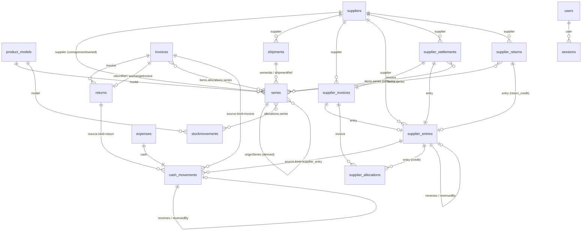

# Poplar v3 — Data Model

Every MongoDB collection used by the system, taken from the Mongoose schemas in `backend/src/models`. Companion documents: [README](../README.md) · [01-overview.md](01-overview.md) · [02-features.md](02-features.md) · [04-api.md](04-api.md).

## Contents

1. [Overview and relationships](#1-overview-and-relationships)
2. [Conventions](#2-conventions) (money, references, timestamps, append-only ledgers, idempotency)
3. [Catalog and stock](#3-catalog-and-stock): `product_models`, `series`, `stockmovements`, `shipments`
4. [Customer sales](#4-customer-sales): `invoices`, `returns`
5. [Cash](#5-cash): `cash_movements`, `expenses`
6. [Suppliers](#6-suppliers): `suppliers`, `supplier_invoices`, `supplier_entries`, `supplier_allocations`, `supplier_settlements`, `supplier_returns`
7. [Employees and payroll](#7-employees-and-payroll): `employees`, `payroll_periods`, `employee_advances`, `employee_ledger`
8. [Platform](#8-platform): `users`, `sessions`, `settings`, `counters`, `_environment`, legacy `products`
9. [Key mechanics](#9-key-mechanics)

---

## 1. Overview and relationships

| Collection | Mongoose model | Purpose |
|---|---|---|
| `product_models` | ProductModel | Product identity, prices, size identity and barcode. **No quantities.** |
| `series` | Series | **Source of truth for quantities**; also ownership and consignment agreement. |
| `stockmovements` | StockMovement | Audit log of every stock change. |
| `shipments` | Shipment | Receive log and its idempotency key. |
| `invoices` | Invoice | Customer sales with snapshot lines. |
| `returns` | Return | Customer returns and exchanges. |
| `cash_movements` | CashMovement | **The two cash accounts' ledger (source of truth for cash).** Append-only. |
| `expenses` | Expense | Operating expenses (each with a linked cash movement). |
| `employees` | Employee | Employee financial profile: salary, currency, pay day, optional link to a login account. |
| `payroll_periods` | PayrollPeriod | One salary period per employee and month, with a salary snapshot and atomic counters. |
| `employee_advances` | EmployeeAdvance | Employee advances with an explicit deduction period and lifecycle. |
| `employee_ledger` | EmployeeLedger | **Append-only payroll ledger** (entitlement, advances, settlements, payments, adjustments, reversals). |
| `suppliers` | Supplier | Supplier master (never hard-deleted). |
| `supplier_invoices` | SupplierInvoice | Supplier invoices (liabilities, no cash effect). |
| `supplier_entries` | SupplierEntry | Append-only supplier ledger. |
| `supplier_allocations` | SupplierAllocation | Append-only allocation of credits to invoices. |
| `supplier_settlements` | SupplierSettlement | Consignment settlements for sold pieces. |
| `supplier_returns` | SupplierReturn | Consignment goods returned to a supplier. |
| `users` | User | Accounts. |
| `sessions` | Session | Server-side sessions. |
| `settings` | Setting | Single document `key: "main"`. |
| `counters` | Counter | Atomic sequences. |
| `_environment` | (raw collection) | Disposable-database marker used by the safety gate. |
| `products` | (raw, legacy) | Old v2 products; never touched by migrations. |

Collection names come from each model's `collection` option, or Mongoose's default pluralisation (`Invoice` → `invoices`, `Return` → `returns`, `StockMovement` → `stockmovements`, `Series` → `series`, `Setting` → `settings`, `Counter` → `counters`, `User` → `users`, `Session` → `sessions`, `Shipment` → `shipments`, `Supplier` → `suppliers`, `Expense` → `expenses`).



Reading the diagram: quantities live in `series` only; `stockmovements` explain how they changed; customer sales point back to the series they consumed so cancellations and returns restore the same series; the cash ledger references the document that caused each movement; supplier records are separate from customer invoices and from stock.

---

## 2. Conventions

### 2.1 Money representation

| Concept | Representation |
|---|---|
| **SYP** (Syrian pound) | Whole pounds. In the ledgers: integer `amountMinor` = pounds. |
| **USD** | Cents. In the ledgers: integer `amountMinor` = cents (`$7,028.00` = `702800`). Input accepts at most 2 decimals. |
| Ledger collections (`cash_movements`, `expenses`, `supplier_entries`, `supplier_invoices`, `supplier_allocations`, `supplier_settlements`) | **Integer minor units** per currency, validated with `Number.isInteger`. All sums, comparisons and balances run on integers. `amount` (major unit) is stored for display on entries/invoices; `amountMinor` is the truth. |
| Customer `invoices` / `returns` | Major-unit numbers in the invoice currency (`unitPrice`, `totalPaid`, `cashDue`, `refundAmount`: USD with 2 decimals, SYP whole), plus USD-side accounting numbers (`unitPriceUsd`, `totalUsd`, `costUsd`, `profitUsd`, 4 decimals). Aggregations convert to minor units per document before summing. |
| Model prices | `costPrice` and `sellPrice` in USD (cost is a weighted average, 4 decimals). |
| Exchange rate | SYP per 1 USD (`settings.usdToSyp`). Stored on each SYP invoice (`rate`) and return (`rateAtReturn`) at the time. Supplier rates are optional, **entered by the user**, documentation only. |

Conversions in code: `toMinorC(currency, n)` / `fromMinorC(currency, m)`; `validAmount(currency, n)` rejects SYP fractions and USD with more than 2 decimals (`INVALID_AMOUNT_PRECISION`). Currencies are never added together.

### 2.2 References and counters

Human-readable references come from atomic counters in `counters` (`{ _id: <name>, seq }`, `findOneAndUpdate $inc` with upsert):

| Counter id | Used for | Format |
|---|---|---|
| `modelno:<PREFIX>` | Model numbers per brand prefix | `FAF-001` |
| `barcode` | Internal size barcodes | `POP-000001` |
| `series` | Series numbers | `SER-000123` |
| `invoice` | Customer invoice number (number field) | `#00012` in the UI, `INV-12` in references |
| `return` | Return number (number field) | `RET-3` |
| `cashMovement` | Cash movements | `CSH-000001` |
| `expense` | Expenses | `EXP-000001` |
| `supplierEntry` | Supplier ledger entries | `SUP-000001` |
| `supplierAllocation` | Allocations (apply and release) | `ALC-000001` |
| `supplierSettlement` | Settlements | `SST-000001` |
| `supplierReturn` | Supplier returns | `SRT-000001` |
| `employee` | Employees | `EMP-000001` |
| `payrollPeriod` | Payroll periods | `PAY-000001` |
| `employeeAdvance` | Employee advances | `ADV-000001` |
| `employeeLedger` | Employee ledger entries | `EL-000001` |

Shipments use `SHP-<last 6 hex of the shipment _id, upper-case>` as their reference. Numbers are consumed even if the surrounding operation later fails, so gaps are possible.

### 2.3 Timestamps, snapshots and immutability

Most schemas use `{ timestamps: true }` (`createdAt`, `updatedAt`). Documents that describe a historical fact store a **snapshot** (model name and prices on an invoice line, agreed price on a settlement item, model description on a movement or series) so later edits never change history. `createdBy`/actor fields are `{ id, name }` pairs (name denormalised).

**Append-only ledgers** (never edited or deleted by application code): `cash_movements`, `supplier_entries`, `supplier_allocations`, `stockmovements`. Corrections are **new opposite records** linked by `reverses` / `reversedBy` (or `releases` / `releasedBy` for allocations); the original is only *marked* once. Pre-created claim documents (`shipments`, `supplier_settlements`, `supplier_returns` while `pending`) are the only ones deleted, and only when an operation fails so the same key can be retried.

### 2.4 Idempotency keys

A unique `idempotencyKey` makes duplicate posting impossible. Callers supply 8–100 characters for shipments, supplier postings, manual cash movements and expenses; the system derives deterministic keys for cash movements produced by other events.

| Collection | Key | Supplied by | Scope |
|---|---|---|---|
| `shipments` | `idempotencyKey` (unique) | client | one shipment |
| `supplier_entries` | `idempotencyKey` (unique, partial: only strings) | client (settlement: `sst:<key>`, supplier return credit: `srt:<key>`) | one entry |
| `supplier_allocations` | `idempotencyKey` (unique, partial) | client for manual allocation | one allocation |
| `supplier_settlements` | `idempotencyKey` (unique) | client | one settlement |
| `supplier_returns` | `idempotencyKey` (unique) | client | one return |
| `expenses` | `idempotencyKey` (unique) | client | one expense |
| `employee_advances` | `idempotencyKey` (unique) | client | one advance |
| `payroll_periods` | `idempotencyKey` (unique, partial: optional) | client (optional; the unique `{employee, periodKey}` also stops duplicates) | one period |
| `employee_ledger` | `idempotencyKey` (unique) | client, prefixed by operation (`salpay:`, `payadj:`, `advsettle:`, `advreassign:`); derived: `payapprove:<periodId>`, `advdisb:<advanceId>`, `entrev:<entryId>` | one ledger entry |
| `cash_movements` | `idempotencyKey` (unique) | derived (payroll: `salpaycash:<ledgerId>`, `advcash:<advanceId>`, `salpayrev:<cashId>`, `advrev:<cashId>`); also: `sale:<invoiceId>`, `salecancel:<originalMovementId>`, `refund:<returnId>`, `supent:<entryId>`, `supentrev:<originalMovementId>`, `exp:<expenseId>`, `exprev:<originalMovementId>`, `manual:<clientKey>`, `manualrev:<movementId>` | one movement |

Beyond keys, other uniqueness constraints stop double effects: one reversal per cash movement (`reverses` unique partial index), one reversal entry per supplier entry (`reverses` unique partial index), one release per allocation (`releases` unique partial index), unique supplier invoice number per supplier.

---

## 3. Catalog and stock

### 3.1 `product_models`

Identity of a model; sizes carry identity only. A model number does **not** identify a physical piece.

| Field | Type | Notes |
|---|---|---|
| `modelNumber` | String, required, **unique**, trim, uppercase | Regex `^[A-Z0-9][A-Z0-9._-]{1,31}$`; format `BRAND-001`; **immutable** in practice (no API changes it). |
| `name`, `brand`, `type` | String, required, trim | `type` = trousers, shirt, jacket... |
| `origin` | `foreign` \| `local`, required | |
| `cut`, `season`, `notes` | String, default `""` | `notes` also keeps the old v2 colour after migration. |
| `costPrice` | Number ≥ 0, required | USD, weighted average (4 decimals). |
| `sellPrice` | Number ≥ 0, required | USD. |
| `sizes[]` | subdocuments (own `_id`) | `{ size, barcode, legacyVariantId }`. `size` required, uppercase, regex `^[A-Z0-9][A-Z0-9./-]{0,9}$`, unique within the model, at least one size. Defaults when creating in the UI: S, M, L, XL. |
| `rev` | Number, default 0 | Optimistic-concurrency counter for the weighted-average cost update. |
| `active` | Boolean, default true | Archive flag; archived models cannot be sold or receive stock. |
| `searchTokens` (select: false), `searchText` (select: false) | derived | Normalised words of name, brand, type, cut and model number, rebuilt on every validation. |
| `legacy` | `{ productId, color, style }` | v2 link. |
| `createdAt`, `updatedAt` | Date | |

Indexes: unique `modelNumber`; **unique partial** `sizes.barcode` (only string barcodes: no two sizes anywhere share a barcode); `searchTokens`; `{ active, brand, type }`; `{ active, updatedAt: -1 }`.

Invariants: quantities are never stored here (the old `shopQty`/`warehouseQty` fields may still exist in migrated documents and are ignored by the code); a size cannot be removed while it has stock, and the last size cannot be removed.

### 3.2 `series`

A group of pieces of one model at one location. **Source of truth for quantities.**

| Field | Type | Notes |
|---|---|---|
| `seriesNo` | String, required, **unique** | `SER-000123`. |
| `model` | ObjectId → `product_models`, required | |
| `modelNumber`, `name`, `nameKey`, `type`, `cut` | String | Descriptive snapshot for search and display (`nameKey` = normalised name). |
| `location` | `shop` \| `warehouse`, required | |
| `kind` | `received` \| `derived` \| `balance`, required | See below. |
| `originSeries` | ObjectId → `series` | Root series, derived series only. |
| `status` | `active` \| `depleted`, default `active` | Depleted series are never deleted. |
| `sizes[]` | `{ size, initialQty, qty, settledQty }` (no `_id`) | `initialQty` = received with the series; `qty` = remaining (integer ≥ 0); `settledQty` = pieces already settled with the supplier (consignment only; advanced by atomic conditional update only). Sizes unique within the series. |
| `receivedAt` | Date, default now | Determines FIFO order (a derived series copies the origin's date; a balance series starts at epoch 0). |
| `shipmentRef` | String | `SHP-…`, `OPENING` (opening series), `MIGRATION` (balance series from migration). |
| `supplier` | ObjectId → `suppliers` | Set for supplier-linked shipments. |
| `ownership` | `owned` \| `consignment`, default `owned` | Who owns the pieces. |
| `consignment.price` | `{ amount, currency (USD/SYP), rate }` | Agreed per-piece price in its own currency; `rate` is documentation only. |
| `consignment.history[]` | `{ kind (set/adjust), at, reason, by{id,name}, previous{amount,currency,rate}, price{…} }` | Append-only price history. |
| `note` | String | |
| `rev` | Number, default 0 | |
| `createdAt`, `updatedAt` | Date | |

`kind`:

- `received` — a physical receipt; subject to the **1–2 pieces per included size** rule (and non-empty).
- `derived` — created by a partial transfer at the destination; linked by `originSeries`; later transfers from the same root to the same destination merge into it.
- `balance` — one per (model, location); holds migrated legacy stock and positive inventory-count adjustments; exempt from the 1–2 rule.

Indexes: unique `seriesNo`; `{ model, location, status, receivedAt }` (FIFO lookup); `{ location, receivedAt: -1 }`; `modelNumber`; `{ supplier, ownership, location, status }`; `nameKey`; **unique partial** `{ originSeries, location }` where `kind = "derived"` (one derived series per origin and destination); **unique partial** `{ model, location }` where `kind = "balance"` (one balance series per model and location).

Invariants: `qty ≥ 0` and integer; only conditional atomic updates change `qty` and `settledQty`; totals and availability are **always aggregated** (`availability.service` via `series.repository.sumBySize`), nothing is stored as a total; consignment series belong to their supplier and derived series inherit supplier, ownership and agreed price; the seed integrity check also asserts that received series never hold more than 2 initial pieces of a size.

### 3.3 `stockmovements`

Audit log of every stock change; written in the same atomic unit as the change.

| Field | Type | Notes |
|---|---|---|
| `type` | enum, required | `sale`, `receive`, `transfer`, `return`, `return_damaged`, `damaged`, `adjust`, `cancel`, `supplier_return`. |
| `model`, `sizeId` | ObjectId | |
| `modelNumber`, `name`, `nameKey`, `brand`, `size` | String | Snapshot so the row stays readable after edits or archive. |
| `qty` | Number, required | Pieces moved (positive). |
| `delta` | Number, default 0 | Effect on total stock (0 for transfer). |
| `from`, `to` | `shop` \| `warehouse` \| null | |
| `before`, `after` | `{ shop, warehouse }` | Quantities of that size before and after (recorded when reliable). |
| `costUsd` | Number, default 0 | Quantity × cost at the time (0 for supplier returns). |
| `reason`, `ref` | String | `ref`: `INV-12`, `RET-3`, `SHP-…`, `SRT-…`, `SER-…`. |
| `batchId` | String | Groups movements of one shipment or supplier return. |
| `allocations[]` | `{ series, seriesNo, qty, location }` | Series touched (FIFO split). For a transfer: source entries (`location = from`) and destination entries (`location = to`). |
| `legacy` | `{ color, style }` | |
| `createdAt`, `updatedAt` | Date | |

Indexes: `{ createdAt: -1 }`, `{ type, createdAt: -1 }`, `{ modelNumber, createdAt: -1 }`, `{ model, createdAt: -1 }`, `{ allocations.series, createdAt: -1 }`.

The net sold quantity of a consignment series is derived from this collection: Σ `sale` − Σ `cancel` − Σ `return` allocations per (series, size).

### 3.4 `shipments`

Receive log and idempotency claim.

| Field | Type | Notes |
|---|---|---|
| `idempotencyKey` | String, required, **unique** | Client key (8–100 chars). |
| `modelNumber`, `location` | String / enum | |
| `items[]`, `series[]` | requested composition | `series[] = { seriesNo, sizes[{ size, qty }] }`. |
| `seriesIds[]` | ObjectId[] | Filled when applied. |
| `unitCostUsd` | Number | |
| `note` | String | |
| `supplier`, `ownership`, `consignmentPrice` | link and agreement | Only for owner-linked shipments. |
| `status` | `pending` \| `applied` | `pending` is the claim; it is deleted on failure and marked `applied` on success. |

A duplicate key returns the first result (`duplicate: true`) once `applied`; while `pending` it answers `SHIPMENT_IN_PROGRESS`; a key reused for a different model answers `IDEMPOTENCY_MISMATCH`.

---

## 4. Customer sales

### 4.1 `invoices`

| Field | Type | Notes |
|---|---|---|
| `number` | Number, required, **unique** | Atomic counter. |
| `currency` | `USD` \| `SYP`, required | |
| `rate` | Number, default 0 | SYP per USD at the sale (0 for USD invoices). |
| `items[]` | snapshot lines (no `_id`), at least 1 | See below. |
| `itemsCount` | Number | Σ quantities. |
| `totalPaid` | Number | Σ `unitPrice × qty`, invoice currency. |
| `creditApplied` | Number, default 0 | Return credit applied (exchange only). |
| `cashDue` | Number | `totalPaid − creditApplied`; negative = refund of surplus credit. |
| `totalUsd`, `costUsd`, `profitUsd` | Number | USD accounting (profit = totalUsd − costUsd). **Redacted for employees.** |
| `status` | `completed` \| `cancelled`, default `completed` | |
| `cancelledAt` | Date | |
| `note` | String | |
| `returnRef` | ObjectId → `returns` | Set on an **exchange invoice** (created by a return). |
| `exchangeOfInvoice` | Number | Number of the invoice being exchanged. |
| `createdAt`, `updatedAt` | Date | |

Item snapshot: `model`, `sizeId`, `modelNumber`, `name`, `brand`, `origin`, `type`, `cut`, `size`, `barcode`, `qty` (≥ 1), `returnedQty` (default 0), `allocations[] { series, seriesNo, qty }` (the FIFO split; absent on pre-series invoices), `costPrice`, `sellPrice`, `unitPrice` (invoice currency), `unitPriceUsd`, `flag` (`normal` / `below_sell_price` / `below_cost`), `legacy`.

Index: `{ createdAt: -1 }`. Invariants: `returnedQty` is advanced only by an atomic conditional update that cannot exceed `qty`; a cancelled invoice cannot be returned against; an invoice with returns or an exchange invoice cannot be cancelled.

### 4.2 `returns`

| Field | Type | Notes |
|---|---|---|
| `number` | Number, required, **unique** | Atomic counter (`RET-n`). |
| `invoice` | ObjectId → `invoices`, required; `invoiceNumber` | |
| `mode` | `cash` \| `exchange`, required | |
| `reason` | String | |
| `items[]` | `{ itemIndex, model, sizeId, modelNumber, name, brand, origin, type, cut, size, barcode, qty, condition (good/damaged), unitPrice, unitPriceUsd, costPrice, legacy }` | Values at the original sale. |
| `currency` | `USD` \| `SYP` | The original invoice's currency. |
| `refundAmount` | Number | Value returned, invoice currency. |
| `refundUsd`, `reversedProfitUsd`, `writeOffUsd` | Number | USD accounting at original values; `writeOffUsd` = cost of damaged pieces. |
| `rateAtReturn`, `refundUsdToday`, `fxDiffUsd` | Number | SYP returns: today's rate, value at today's rate, the difference. |
| `cashRefund` | Number, default 0 | = `refundAmount` in cash mode, 0 in exchange mode. |
| `exchangeInvoice`, `exchangeInvoiceNumber` | link | Set in exchange mode. |
| `createdAt`, `updatedAt` | Date | |

Index: `{ createdAt: -1 }`. The allocations used to restore pieces are read from the invoice items, not duplicated here.

---

## 5. Cash

### 5.1 `cash_movements` — the two accounts' ledger

Append-only, immutable. **The only source of cash balances.** Balance per currency = Σ(`in`) − Σ(`out`).

| Field | Type | Notes |
|---|---|---|
| `ref` | String, required, **unique** | `CSH-000001`. |
| `currency` | `USD` \| `SYP`, required | Affected account = currency of the actual settlement. |
| `direction` | `in` \| `out`, required | |
| `amountMinor` | Number, required, integer ≥ 1 | USD cents / whole SYP. |
| `type` | enum, required | `sale_receipt`, `sale_cancellation`, `customer_refund`, `supplier_payment`, `supplier_advance`, `supplier_reversal`, `expense`, `expense_reversal`, `deposit`, `withdrawal`, `reversal`, `employee_advance`, `salary_payment`, `payroll_reversal`. |
| `source` | `{ kind, id, ref }`, `kind` required | `invoice`, `return`, `supplier_entry`, `expense`, `manual`, `employee_advance`, `payroll_payment`. |
| `supplier` | ObjectId → `suppliers` | For supplier payments. |
| `date` | Date, required | Actual movement date (used by period reports). |
| `note` | String ≤ 500 | |
| `reverses` / `reversedBy` | ObjectId → `cash_movements` | Link between an original and its opposite movement. |
| `idempotencyKey` | String, required, **unique** | See 2.4. |
| `createdBy` | `{ id, name }` | |
| `createdAt`, `updatedAt` | Date | |

Indexes: unique `idempotencyKey`; `{ currency, date: -1, _id: -1 }`; `{ source.kind, source.id }`; **unique partial** `{ reverses }`; `{ type, currency, date: -1 }`.

Invariants: no update or delete; one reversal per movement; reversal has the same currency and amount and the opposite direction; invoices, supplier invoices, settlements, credit notes, return credits, debit adjustments and allocations **never** create movements. The integrity check re-derives each currency's balance from source documents and compares it with this ledger.

### 5.2 `expenses`

| Field | Type | Notes |
|---|---|---|
| `ref` | String, required, **unique** | `EXP-000001`. |
| `currency` | `USD` \| `SYP` | |
| `amountMinor` | integer ≥ 1 | |
| `category` | String, required, ≤ 60 | |
| `description` | String ≤ 300 | |
| `date` | Date, required | |
| `status` | `posted` \| `reversed`, default `posted` | |
| `cash` | ObjectId → `cash_movements` | The linked outflow. |
| `idempotencyKey` | String, required, **unique** | |
| `reversal` | `{ at, reason, by{id,name} }` | Set when reversed (the cash outflow is reversed with `expense_reversal`). |
| `createdBy` | `{ id, name }` | |

**Salary expenses (payroll link, optional fields):** `employee` (→ `employees`), `periodKey` (`YYYY-MM`), `payrollEntry` (→ `employee_ledger` salary payment) and `method` (`cash` default \| `other`). A salary expense with `method: other` has **no** `cash` movement (no fictitious cash); with `cash` it has exactly one cash movement `type: expense`. Category «رواتب» (`SALARY_EXPENSE_CATEGORY`). Partial index `{ employee, date: -1 }`. Reversing it also reverses the payment ledger entry (see section 7).

Indexes: unique `ref`, unique `idempotencyKey`, `{ currency, date: -1 }`, `{ category, currency }`.

---

## 6. Suppliers

All supplier money is stored **per currency in integer minor units** and never converted or summed across currencies.

### 6.1 `suppliers`

`name` (required, ≤ 120), `nameKey` (normalised name, required), `phone` (≤ 40), `phoneKey` (digits only), `address` (≤ 300), `notes` (≤ 1000), `active` (default true), timestamps. Indexes: `nameKey`, `phoneKey`, `{ active, createdAt: -1 }`. Never hard-deleted (deactivated). The same normalised name + phone triggers a `DUPLICATE_SUPPLIER` warning unless the caller passes `allowDuplicate`.

### 6.2 `supplier_invoices`

Liabilities in their own currency; **no cash effect**. Paid/remaining is **computed** from allocations, never stored.

| Field | Notes |
|---|---|
| `supplier` (required), `invoiceNo` (≤ 60), `invoiceKey` (normalised: trimmed, whitespace collapsed, upper-case) | **Unique per supplier**: `{ supplier, invoiceKey }`. |
| `kind` | `purchase` (default) \| `consignment_settlement` (created by the settlement workflow only). |
| `invoiceDate` (required), `dueDate` | Due date may not precede the invoice date. |
| `currency`, `amount`, **`amountMinor`** | `amountMinor` is the truth; `amount` is the display value. |
| `rate`, `valuationUsdMinor` | Optional documentation of an entered rate. |
| `terms`, `note`, `seriesNos[]`, `shipmentRefs[]` | `seriesNos`/`shipmentRefs` are references only. |
| `status` | `posted` \| `reversed`. |
| `entry` | → the `purchase` entry in `supplier_entries`. |
| `amountUsd`, `amountUsdMinor` | Legacy (read only). |
| `createdBy`, timestamps | |

Indexes: unique `{ supplier, invoiceKey }`, `{ supplier, invoiceDate: -1 }`.

### 6.3 `supplier_entries` — the supplier ledger

Append-only. Corrections are `reversal` entries.

| Field | Notes |
|---|---|
| `ref` | Unique, `SUP-000123`. |
| `supplier` (required), `type` (required) | `purchase`, `adjustment`, `payment`, `advance`, `credit`, `return_credit`, `reversal`. |
| `currency` (required), `amount`, **`amountMinor`**, **`signedMinor`** | `signedMinor` > 0 increases what the store owes (invoice, debit adjustment); < 0 reduces it (payment, advance, credit note, return credit). A reversal carries the opposite sign of its original. |
| `rate`, `valuationUsdMinor` | Entered rate / historical USD equivalent, **documentation only**. |
| `crossCurrency` | `{ invoiceCurrency, settlesMinor, rate }` for a payment made in a different currency from its invoice. |
| `date` (required), `note` (≤ 500) | `date` is the accounting date. |
| `invoice`, `supplierReturn` | Links. |
| `reverses` / `reversedBy` | Original ↔ reversal. |
| `idempotencyKey` | Unique when present (partial index). |
| `createdBy`, timestamps | |
| `delta`, `amountUsd`, `usdMinor`, `deltaMinor` | Legacy USD-equivalent fields: read only, never written. |

Indexes: `{ supplier, date, _id }`, `{ invoice }`, unique partial `{ idempotencyKey }`, unique partial `{ reverses }`.

Cash relation: only `payment` and `advance` entries have a `cash_movements` row (`source.kind = supplier_entry`); everything else has none.

### 6.4 `supplier_allocations`

Append-only records that apply a credit entry to an invoice.

| Field | Notes |
|---|---|
| `ref` | Unique, `ALC-000123`. |
| `supplier`, `kind` | `apply` \| `release`. |
| `entry` | The credit entry (`payment`, `advance`, `credit`, `return_credit`). |
| `invoice` | The supplier invoice. |
| `currency`, `amountMinor` | Invoice side (the amount applied to the invoice, in the invoice's currency). |
| `creditCurrency`, `creditMinor` | Credit side (amount consumed from the credit, in the credit's currency). |
| `crossCurrency`, `rate` | `true` only with explicit confirmation and an entered rate. |
| `needsReview` | Legacy record with ambiguous units: excluded from all balances until reviewed. |
| `source` | `direct` (payment linked to an invoice at posting), `manual`, `auto`, `release`. |
| `releases` / `releasedBy` | A `release` record points to the `apply` it undoes; the original gets `releasedBy`. |
| `note`, `idempotencyKey` (unique partial), `createdBy`, timestamps | |

Same-currency allocations have `amountMinor = creditMinor`. Indexes: `{ supplier, createdAt }`, `{ entry }`, `{ invoice }`, unique partial `idempotencyKey`, unique partial `{ releases }`. **Never creates a cash movement** (the money left when the payment/advance was paid). After every posting, bounds are re-checked inside the atomic unit: allocations on a credit never exceed its amount; allocations on an invoice never exceed its amount.

### 6.5 `supplier_settlements`

Consignment settlement for pieces already sold.

| Field | Notes |
|---|---|
| `number` (unique), `ref` | `SST-000001`. |
| `supplier`, `idempotencyKey` (unique) | |
| `currency` | One currency per settlement. |
| `items[]` | `{ series, seriesNo, model, modelNumber, name, size, qty, unitAmount, currency, rate, lineAmount, lineMinor }` — agreed-price **snapshot** per line. |
| `totalQty`, `totalMinor` | `totalMinor` = Σ `lineMinor`. |
| `status` | `pending` (claim) → `posted` → `reversed`. |
| `invoice`, `entry` | The generated `consignment_settlement` supplier invoice and `purchase` entry. |
| `reversal` | `{ at, reason, by, entry }`. |
| `note`, `createdBy`, timestamps; legacy `totalUsdMinor`, `lineUsdMinor` | |

Index: `{ supplier, createdAt: -1 }`. Effects are atomic with `series.sizes.settledQty` increments; reversal releases them.

### 6.6 `supplier_returns`

| Field | Notes |
|---|---|
| `number` (unique), `ref` | `SRT-000001`. |
| `supplier`, `idempotencyKey` (unique) | |
| `items[]` | `{ series, seriesNo, model, modelNumber, name, size, qty, agreedUnit{amount,currency}, location }`; `agreedUnit` absent when the series had no agreed price. |
| `totalQty` | |
| `value` | `{ USD, SYP }` estimate per currency from the agreed prices (not a ledger figure). |
| `unpricedQty` | Pieces without an agreed price (manual reconciliation). |
| `reason` (≤ 300) | |
| `status` | `pending` (claim) → `applied`. |
| `entry` | The linked `return_credit` entry, only if the owner supplied a credit. |
| `createdBy`, timestamps; legacy `valueUsd` | |

Index: `{ supplier, createdAt: -1 }`.

---

## 7. Employees and payroll

Salaries, advances and payments of **employees as a financial subject**. This is separate from login accounts (`users`): an `employees` document may link to one `users` document (optional, unique, never the owner account), but payroll does not depend on it. All amounts are **integers in minor units** (USD cents / whole SYP) in the employee's single currency; there is no cross-currency sum or conversion anywhere. All four collections are created by `migrate:suppliers` (it syncs every model's indexes).

### 8.1 `employees`

| Field | Type | Notes |
|---|---|---|
| `number` | String, required, **unique** | `EMP-000001`. |
| `name`, `nameKey` | String, required | `nameKey` is the normalised name for search. Index `{ nameKey }`, `{ status, nameKey }`. |
| `jobTitle`, `phone`, `notes`, `hireDate` | | Optional. |
| `status` | `active` \| `inactive` \| `terminated` | Only active employees get new periods or advances. |
| `user` | ObjectId → `users` | Optional; **unique partial index**. |
| `salaryMinor` | integer ≥ 0 | Current salary. Changing it never touches existing periods (they keep a snapshot). |
| `currency` | `USD` \| `SYP`, required | Locked once the employee has any period or advance. |
| `payDay` | 1–28, default 1 | Salary due day each month. |
| `salaryEffectiveFrom` | `YYYY-MM`, optional | First month the current salary is known to apply. Set on every salary change (current month) or by explicit owner declaration; when absent (older records) the month of `createdAt` is used. **No period is created for a month before it, nor before the hire month** (`BEFORE_HIRE`, `HISTORICAL_SALARY_UNKNOWN`). |
| `createdBy`, `updatedBy` | `{ id, name }` | Audit. |

### 8.2 `payroll_periods`

One per `(employee, periodKey)` (**unique index**; `periodKey` = `YYYY-MM`).

| Field | Type | Notes |
|---|---|---|
| `ref` | String, **unique** | `PAY-000001`. |
| `employee`, `periodKey`, `start`, `end`, `dueDate`, `currency` | | Bounds are UTC month start/end; `dueDate` = `payDay`. |
| `baseSalaryMinor` | integer | **Snapshot** of the salary when the period was created. |
| `allowancesMinor`, `bonusesMinor`, `deductionsMinor` | integer ≥ 0 | Totals of the posted allowance / bonus / deduction entries. Locked after approval. |
| `settledMinor` | integer ≥ 0 | Advance settlements applied to this period. |
| `paidMinor` | integer ≥ 0 | Salary payments made. |
| `status` | `draft` → `approved` (automatically at the first salary payment) → `partially_paid` → `paid` → `closed` | `partially_paid` / `paid` are **derived** inside the database by the same update that changes a counter. |
| `approvedAt/By`, `closedAt/By` | | Approval and closure metadata. |

**Single authoritative calculation** (`utils/payroll.js`, mirrored as a MongoDB expression in `repositories/payroll.repository.js`):

```
net       = base + allowances + bonuses - deductions
remaining = net - settled - paid          (never below 0)
```

Allowances, bonuses and deductions use a variant of the guard (`adjustComponent`): status `draft`, or `approved` with `paidMinor = 0` and `settledMinor = 0`. Every counter change is one conditional `findOneAndUpdate` with an aggregation-pipeline update: its filter requires an allowed `status` and `remaining >= 0` after the change, and its second stage re-derives `status`. Two concurrent payments therefore cannot exceed the remaining amount. A disbursed advance changes nothing here until a **settlement** is posted, so an advance can never be subtracted twice.

Indexes: unique `{ employee, periodKey }`; `{ periodKey, status }`; `{ status, dueDate }`; unique partial `{ idempotencyKey }`.

### 8.3 `employee_advances`

| Field | Type | Notes |
|---|---|---|
| `ref` | String, **unique** | `ADV-000001`. |
| `employee`, `currency` | | Currency must equal the employee's and the deduction period's. |
| `amountMinor` | integer ≥ 1 | |
| `settledMinor` | integer ≥ 0 | Settled so far; outstanding = amount − settled. |
| `deductionPeriod` | ObjectId → `payroll_periods`, **required** | Defaults to the nearest open month when recorded from the employee account (or chosen explicitly). Moved only by (a) the explicit `reassign` action (before any settlement, to an open period of the same employee and currency) or (b) the system **carry-forward** when a settlement leaves an unsettled remainder (allowed after partial settlements; same advance row, no new disbursement). Both are logged in the ledger as an `adjustment`. |
| `status` | `pending` → `disbursed` → `partially_settled` → `settled`; or `cancelled` (from pending) / `reversed` (from disbursed, no settlements) | Every transition is a compare-and-set update. |
| `disbursement` | `{ at, method: cash \| other, cash → cash_movements, by }` | `cash` creates a real outflow in the currency's register; `other` creates **no** cash movement. |
| `reversal` | `{ at, reason, by }` | |
| `idempotencyKey` | unique | |
| `requestHash` | String, optional | SHA-256 fingerprint of the creating request; the same key with a different request → 409. Absent on older records (previous behaviour kept). |

Indexes: unique `{ idempotencyKey }`; `{ employee, status, createdAt }`; `{ deductionPeriod, status }`; `{ status, createdAt }`.

### 8.4 `employee_ledger`

Append-only and immutable (the only deletion is the compensating rollback of an entry whose transaction did not finish, in non-transactional mode). `amountMinor` is always positive; `type` defines the effect.

| `type` | Effect on the period | Posted when |
|---|---|---|
| `salary_entitlement` | informational (= base snapshot) | period approval |
| `allowance` / `bonus` / `deduction` | `allowancesMinor` / `bonusesMinor` / `deductionsMinor` | draft period only |
| `advance_disbursement` | none (informational) | advance disbursed |
| `advance_settlement` | `settledMinor` | settlement |
| `salary_payment` | `paidMinor` | payment |
| `adjustment` | none (audit record) | deduction period moved, or **carry-forward** of the unsettled remainder to the next eligible month |
| `reversal` | undoes `reverseOf` | reversal |

Other fields: `requestHash` (optional request fingerprint bound to the idempotency key; absent on older entries), `ref` (`EL-000001`, unique), `employee`, `period`, `advance`, `currency`, `date`, `note`, `cash` (→ `cash_movements`, for cash payments), `expense` (→ `expenses`, for salary payments made through Finance → Expenses; legacy payments have only `cash` with source `payroll_payment`), `reverses` (**unique partial**) / `reversedBy`, `idempotencyKey` (**unique**), `createdBy`. Indexes: `{ employee, date: -1, _id: -1 }`, `{ period, type }`, `{ advance, type }`.

Integrity rule (tested): a period's counters equal the sum of its ledger entries that are neither reversed nor reversal rows (`countersFromLedger`).

## 8. Platform

### 7.1 `users`

`name` (required, ≤ 80), `username` (required, **unique**, lowercase, ≤ 64), `passwordHash` (scrypt string `scrypt$N$r$p$salt$hash`), `role` (`admin` \| `employee`), `permissions` (string array; employees only; admin ignores it; owner-only permissions are filtered out), `active` (default true), `tokenVersion` (default 0; incremented when permissions, status or password change), `lastLoginAt`, timestamps. API responses never include `passwordHash` or `tokenVersion`.

### 7.2 `sessions`

`sidHash` (**unique**; HMAC-SHA256 of the session id with `SESSION_SECRET` — the raw id is never stored), `user` (indexed), `csrf`, `tokenVersion` (must equal the user's), `createdAt`, `lastSeenAt`, `expiresAt` (**TTL index** `expireAfterSeconds: 0` — MongoDB removes expired sessions), `ip`, `userAgent` (≤ 200).

### 7.3 `settings`

Single document `{ key: "main" (unique), usdToSyp (default 0, ≥ 0), lowStockThreshold (default 2, deprecated and unused) }`, created on first read.

### 7.4 `counters`

`{ _id: String, seq: Number }`; see 2.2.

### 8.5 `_environment`

Raw collection with one document `{ _id: "environment", disposable: true, database, hosts, markedAt, note }`, created once by `reset-dev --mark-disposable`. It is excluded from reset and recognised by the safety gate as a project collection.

### 8.6 `products` (legacy)

The v2 product collection. Never modified or deleted by any migration; kept so the v2 to v3 migration can be re-run safely.

---

## 9. Key mechanics

- **Stock identity:** a model number identifies a design, not a piece. Pieces exist only as quantities in series.
- **FIFO:** `series.service.consume` reads candidate series ordered by `receivedAt` then `_id`, plans the take, and applies each decrement with a conditional update (`qty ≥ take`); on conflict it undoes partial work and re-plans (max 5 attempts). `restore` puts pieces back into the recorded series; legacy invoices without allocations restore into the shop balance series.
- **Atomicity:** writes are conditional atomic updates (`$inc` with guards). Multi-document operations (sale + cash, refund + cash, payment + allocation + cash, settlement, supplier return, shipment, transfer, cancellation) run in `runAtomic`: a MongoDB transaction on a replica set, otherwise compensating rollback via `ctx.undo`. Reads that share a transaction session run sequentially.
- **Availability:** `availability.service` aggregates series into per-size shop/warehouse quantities; presenters then derive `availability`, `canTransfer`, `needsFactoryRestock` and totals.
- **Weighted-average cost:** on receive with a cost, `newCost = round((existingPieces × costPrice + newPieces × unitCost) / (existingPieces + newPieces), 4)`, guarded by `rev`.
- **Search:** name search matches word prefixes (`boot` finds *bootcut*); a mid-word match is only a fallback when there are no results. Text is normalised (diacritics, alef/yaa/taa marbuta).
- **QR payload:** `PLP1:<modelNumber>` (prefix `PLP`, version 1). Obsolete versions are rejected with a clear message.
- **Money:** integer minor units in ledgers; customer documents keep major-unit numbers (USD 2 decimals, SYP whole) and USD accounting at 4 decimals; `computeFlag` compares the USD price with cost and selling price.
- **Supplier positions:** computed per currency from entries and allocations on read (gross payable = live invoices + debit adjustments − applied allocations; advance = live credits − credit consumed; net = gross − advance); statuses `settled`, `due`, `advance`, `mixed`.
- **Sold / settled quantities:** net sold per (series, size) is derived from `sale`/`cancel`/`return` movement allocations; `settledQty` is a conditional-update counter that can never exceed it, so a sold piece cannot be settled twice.
- **Reversals:** a new entry with the opposite sign/direction; the original gets one `reversedBy`. Reversing a credit releases its live allocations and, for a payment/advance, reverses the cash movement; an invoice with live allocations cannot be reversed; settlement invoices are reversed through the settlement.
- **Payroll:** salary entitlement, advance settlement and payment are separate, authoritative steps (section 7); cash moves only for real cash payments/disbursements, through the same `cash.post` as every other cash event; posted entries are corrected only by reversal entries.
- **Historical data:** invoices, returns and supplier payments made before the cash ledger existed have no cash movements; the migration and the Finance dashboard only **report** them.
